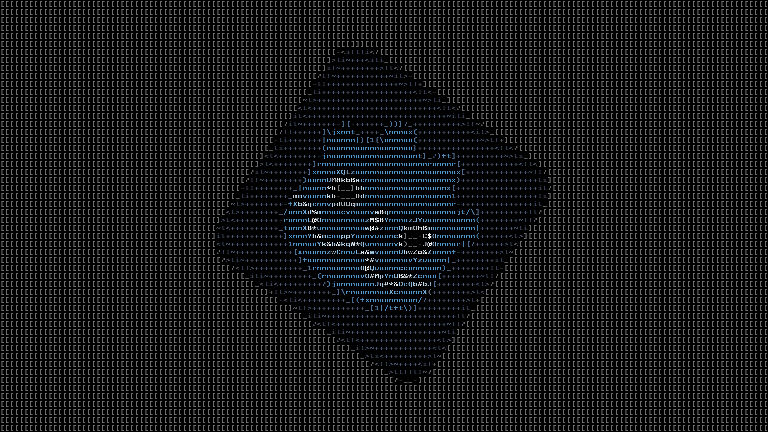

# Godot ASCII Renderer

A two-step Godot shader that converts a texture to a grid of colored characters.

All files in [project/](project/) except those excluded by [project/NOTICE](project/NOTICE) are availalbe under a [CC0 License](project/LICENSE).

# Attribution

[**JetBrainsMono-Bold.ttf**](atlas/JetBrainsMono-Bold.ttf): From [JetBrains Mono](https://www.jetbrains.com/lp/mono/) ([SIL Open Font License 1.1](https://github.com/JetBrains/JetBrainsMono/blob/master/OFL.txt))

**Demo**: Dodge the Creeps from [godot-demo-projects](http://github.com/godotengine/godot-demo-projects/) ([MIT License](demo/LICENSE))